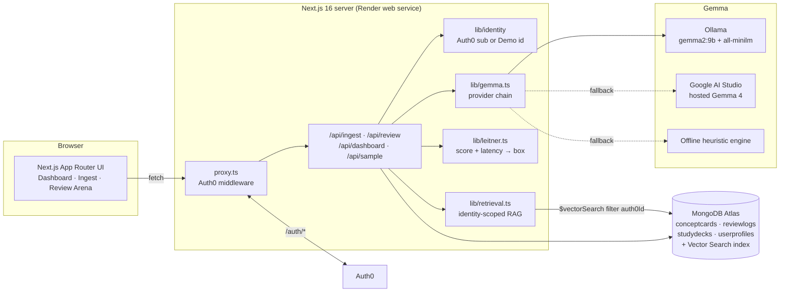
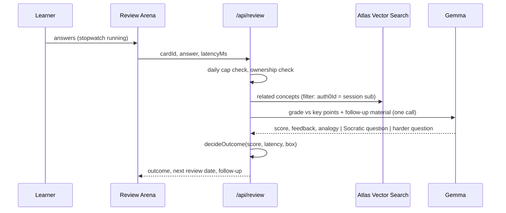

# DeepRetain: The Forgetting-Curve Knowledge Engine

> Study less. Remember more. An anti-cramming study companion built on open-weight **Gemma**.

DeepRetain turns dense lecture notes into a handful of **micro-reviews a day**. Gemma extracts atomic concepts, then a **latency-aware Leitner system** decides when you see each one again, based on *how accurately* and *how fluently* you recall it. A **daily cognitive cap** stops you before cramming starts. Spacing does the rest while you sleep.

Built for the **Hacktoberfest 2026 Open-Source AI Challenge, Week 3: "Slow and Steady"**.

## The lazy payoff

Cramming feels productive and decays in days. DeepRetain asks for about **15 short answers a day, at most**, and schedules them at the moment you're about to forget. That's when a single recall does the most good. You put in less effort, and you keep the memory longer.

| What you do | What DeepRetain does |
|---|---|
| Paste notes once | Gemma splits them into atomic concepts, key points, and a first question |
| Answer one card | A quiet stopwatch measures recall latency while Gemma grades meaning, not wording |
| Answer fast and right | The card climbs a Leitner box (1 → 3 → 7 → 14 → 30 days), and the next question gets harder |
| Answer right but slowly | Hesitation detected: the card stays put and Gemma asks a Socratic follow-up |
| Answer wrong | Back to Box 1, with a two-sentence analogy that fixes the misconception |
| Hit 15 reviews | "Memory Consolidation Active". Cramming mode is locked until tomorrow |

## Features

- **Note ingestion and concept chunking.** Gemma 2 turns Markdown notes into `conceptTitle`, `coreFact`, `initialQuestion`, and `expectedKeyPoints`, then embeds each concept as a **384-dim vector** (`all-minilm`) for MongoDB Atlas Vector Search.
- **Latency-aware Socratic review arena.** One card at a time, with a distraction-free stopwatch (hideable, and it pauses while the tab is hidden). Gemma returns a 0–100 semantic score that is combined with `responseLatencyMs`.
- **Adaptive difficulty.** Box 1 asks *recall* questions, Box 2 *application*, and Box 3+ *synthesis*. On promotion, Gemma writes the next, harder question, often linking the concept to a related one from your own deck.
- **Identity-scoped RAG.** Related concepts come from Atlas Vector Search, **pre-filtered by the signed-in Auth0 `sub`** and re-checked before anything reaches the prompt. Gemma never sees another learner's notes.
- **Anti-cramming pacer.** A daily cognitive cap (default 15) counted on the learner's local day, with a rest screen that explains why spacing beats cramming.
- **Forgetting-curve dashboard.** Leitner box distribution, a modeled *Cramming vs DeepRetain* retention curve, and a recall-latency trendline with a 7-day average.
- **Always demo-able.** Demo Mode needs no account, and one click loads an AP Biology or CS deck with three weeks of sample history. If no Gemma endpoint is reachable, an offline engine keeps the loop working.

## Architecture



### Review flow



### Leitner rules (`lib/leitner.ts`)

| Accuracy | Latency | Outcome | Box | Next review |
|---|---|---|---|---|
| ≥ 80% | < 12s | **Promote** and generate a harder question | +1 (max 5) | 1 / 3 / 7 / 14 / 30 days by new box |
| ≥ 80% | ≥ 12s | **Hesitation**: Socratic follow-up | unchanged | current box interval |
| < 80% | any | **Reset**: two-sentence analogy | 1 | 1 day |

New concepts are due right away for their first recall pass, then follow the box intervals.

### Gemma provider chain (`lib/gemma.ts`)

1. **Ollama** (`OLLAMA_BASE_URL`): Gemma 2 with Ollama structured outputs (a JSON schema in `format`). The model is warmed on dashboard load.
2. **Google AI Studio** (`GEMINI_API_KEY`): hosted Gemma 4 (`gemma-4-26b-a4b-it`) for cloud demos, with a JSON response schema. Grading uses minimal thinking (about 4–5s per answer), and extraction uses high thinking (about 7s per deck) for better coverage. Models that reject these options are retried in plain mode.
3. **Offline heuristic engine**: lexical key-point coverage plus templated Socratic questions and analogies.

Every response reports the engine that produced it, and the header badge shows which one is active.

## Tech stack

| Layer | Choice |
|---|---|
| Framework | Next.js 16 (App Router, Cache Components, `proxy.ts`), React 19, TypeScript |
| UI | Tailwind CSS 4, Lucide icons, Recharts 3 |
| AI | Gemma 2 on Ollama (`gemma2:9b` / `gemma2:2b`), `all-minilm` embeddings, Gemma 4 on Google AI Studio as the hosted fallback |
| Data | MongoDB Atlas with Mongoose 9 and Atlas Vector Search (384-dim, cosine, filtered by `auth0Id`) |
| Auth | `@auth0/nextjs-auth0` v4, plus Demo Mode for judges |
| Deploy | Render Blueprint (`render.yaml`) |
| Tests | Vitest (Leitner rules, retention maths, pacer, JSON parsing, heuristic engine, provider chain, authz guards) |

## Run it locally

**Prerequisites:** Node 20.9+, an Atlas cluster (the free M0 works), and [Ollama](https://ollama.com).

```bash
ollama pull gemma2:9b       # or gemma2:2b on smaller machines
ollama pull all-minilm      # 384-dim embeddings
```

```bash
npm install
cp .env.example .env.local  # then fill in MONGODB_URI (Auth0 and Gemini keys are optional)
npm run db:vector-index     # creates the Atlas Vector Search index and waits until it is READY
npm run dev                 # http://localhost:3000
```

Open the app, click **Try Demo Mode**, then **Load Sample AP Biology Deck**. Answer quickly and correctly to see a promotion, take more than 12 seconds to trigger a Socratic follow-up, or answer wrong to get an analogy.

### Scripts

| Command | What it does |
|---|---|
| `npm run dev` | Dev server (Turbopack) |
| `npm run build && npm start` | Production build and server (what Render runs) |
| `npm test` | Unit tests |
| `npm run typecheck` / `npm run lint` | TypeScript and ESLint |
| `npm run db:vector-index` | Create the Atlas Vector Search index from `atlas/vector-index.json` |

## Configure services

### MongoDB Atlas
1. Create a cluster and a database user, then copy the `mongodb+srv://` URI into `MONGODB_URI`.
2. In **Network Access**, allow your IP. For Render, allow `0.0.0.0/0` (Render's free tier has no static IPs).
3. Run `npm run db:vector-index`, or create the index by hand from [`atlas/vector-index.json`](atlas/vector-index.json): a `vectorSearch` index on `conceptcards.embedding` (384 dims, cosine) with filter fields `auth0Id` and `embeddingModel`.

Without the index, retrieval falls back to in-app cosine similarity over the same user-scoped documents.

### Auth0 (optional)
1. Create a **Regular Web Application**.
2. Allowed Callback URL: `https://<your-app>/auth/callback`. Allowed Logout URL: `https://<your-app>`.
3. Set `AUTH0_DOMAIN`, `AUTH0_CLIENT_ID`, `AUTH0_CLIENT_SECRET`, and `AUTH0_SECRET` (`openssl rand -hex 32`).

When these are missing, the app runs in Demo Mode only and hides the sign-in button.

### Hosted Gemma fallback (optional)
Add a free Google AI Studio key as `GEMINI_API_KEY`. `GOOGLE_GEMMA_MODEL` picks the Gemma model served there (default `gemma-4-26b-a4b-it`; `gemma-4-31b-it` also works). To see which Gemma models your key can use, list `https://generativelanguage.googleapis.com/v1beta/models`.

## Deploy to Render

1. Push this repository to GitHub.
2. In Render, choose **New → Blueprint**, select the repo, and Render reads [`render.yaml`](render.yaml).
3. Fill in the prompted secrets. `MONGODB_URI` is required, the rest are optional. `AUTH0_SECRET` is generated for you, and `APP_BASE_URL` defaults to Render's external URL.
4. Add `https://<service>.onrender.com/auth/callback` to your Auth0 application.

**Showing live Gemma 2 on the cloud deploy:** Render has no GPU, so either set `GEMINI_API_KEY` (hosted Gemma) or expose your local Ollama with a tunnel (for example `cloudflared tunnel --url http://localhost:11434`) and set `OLLAMA_BASE_URL` to the tunnel URL.

## Demo Mode

**Try Demo Mode** sets an httpOnly cookie with a random `demo|<uuid>` learner id, so every judge gets an isolated workspace. That id format can never collide with or impersonate an `auth0|…` user. **Reset** wipes the demo learner's data, and **Exit** clears the cookie. Set `DEMO_MODE_ENABLED=false` to turn it off.

Sample decks include three weeks of **simulated** review history so the charts have a trend to show. Those logs are flagged `simulated: true`, labeled in the UI, and never count toward the daily cap.

## API

| Route | Purpose |
|---|---|
| `POST /api/ingest` | `{ deckTitle, rawText }` → Gemma extraction → embeddings → cards in Box 1 |
| `POST /api/review` | `{ mode: "answer", cardId, answer, latencyMs, tzOffsetMinutes }` → grade, Leitner move, log. `{ mode: "followup", reviewLogId, answer }` → Socratic reply |
| `GET /api/dashboard?tz=` | Due cards, box stats, cap status, latency trend, retention curves |
| `POST /api/sample` | `{ deck: "bio" \| "cs" }` → curated sample deck |
| `POST/DELETE /api/demo` | Enter Demo Mode, or reset it (`?exit=1` to leave) |
| `GET /api/health` | Mongo, Ollama, AI Studio, and Auth0 status (Render health check) |

All data routes resolve the caller first and scope every query by `auth0Id`.

## Project structure

```
app/                 App Router pages and API routes
components/          AppShell, Landing, dashboard charts, ingest editor, review arena
lib/gemma.ts         extractConceptsFromNotes · evaluateAndFollowUp · replyToFollowUp
lib/ai/              Ollama / Google AI Studio / heuristic providers, prompts, embeddings
lib/leitner.ts       Box rules (accuracy × latency)
lib/retrieval.ts     Identity-scoped Atlas Vector Search
lib/retention.ts     Forgetting-curve and latency-trend maths
lib/pacer.ts         Daily cognitive cap
models/              ConceptCard · ReviewLog · StudyDeck · UserProfile
scripts/             Atlas vector index setup
tests/               Vitest suites
render.yaml          Render Blueprint
```

## Notes on the charts

Chart colors were checked with a colorblind-safety validator against the dark slate surface: emerald `#059669` and orange `#d95926` for the two retention curves, and indigo `#6366f1` for single-series charts. Every multi-series chart has a legend, and every chart has hover tooltips.

## License

MIT. See [LICENSE](LICENSE).
