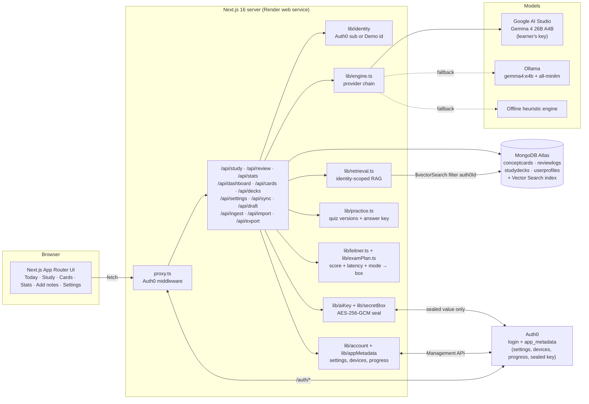
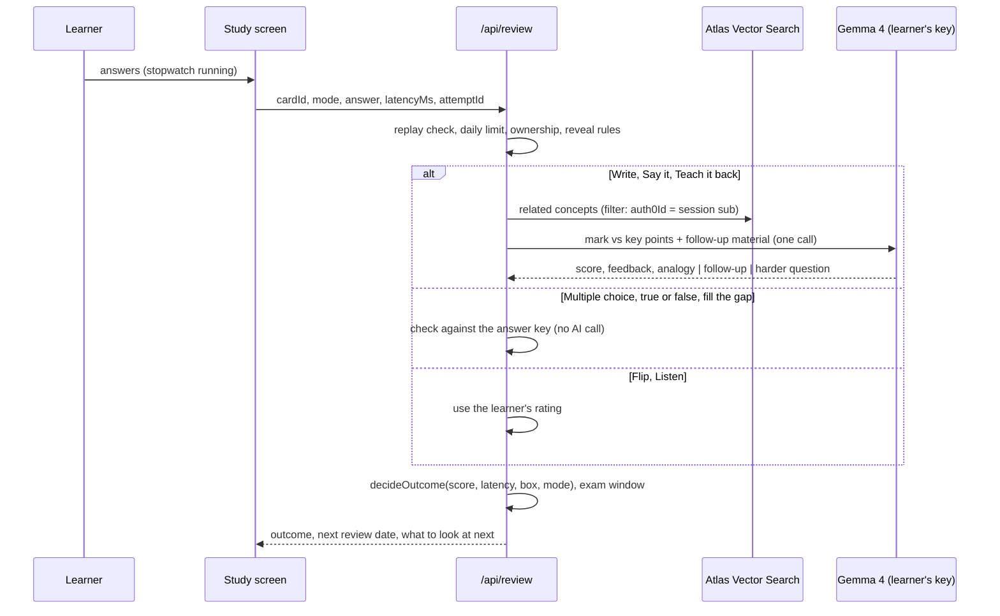

# DeepRetain: The Forgetting-Curve Knowledge Engine

> Study less. Remember more. A study notebook that turns your notes into a few short reviews a day, and won't let you cram.

DeepRetain splits dense lecture notes into single concepts. A **latency-aware Leitner system** then decides when you see each one again, based on *how accurately* and *how quickly* you recall it. A **daily limit** stops you before cramming starts. Spacing does the rest.

There are nine ways to study, from one-tap multiple choice on a tired evening to explaining an idea out loud. Every answer feeds a Stats tab with the numbers worth looking at. Your settings, devices and progress follow your Auth0 account, so you can start on your phone and finish on your laptop.

Built for the **Hacktoberfest 2026 Open-Source AI Challenge, Week 3: "Slow and Steady"**.

## How this entry fits Week 3

**Open-weight AI at the core.** Everything that needs judgment is done by **Gemma 4**, Google's open model family (Apache 2.0):

- turning your notes into concept cards, each with key points and a first question;
- writing the multiple-choice, fill-the-gap and true-or-false versions of each card, plus a harder *application* and *synthesis* question for later boxes;
- marking written, spoken and teach-back answers on meaning rather than wording, and naming the key points you missed;
- the follow-up question after a slow answer, the analogy after a wrong one, and "Explain it differently" on request.

**What isn't AI, and says so in the app.** Multiple choice, true or false and fill the gap are checked against an answer key. Gemma wrote that key, or a simple rule built it from your card while Gemma's version is still on its way. Flip and Listen go by your own rating. The schedule itself is plain code in [`lib/leitner.ts`](lib/leitner.ts). **Only an answer Gemma has marked can carry a card into the last box**: the quick modes stop at box 3 or 4.

There is no closed-model fallback. Without a key or an Ollama server, an open-source heuristic grader in this repo keeps the loop going.

**Rewards laziness.**
- A daily limit (15 by default). You can lower it any time, or raise it up to 25, but a raise only starts tomorrow.
- One-tap modes, **Auto** (it picks the mode for each card), **Just five** and hands-free **Listen**.
- A *laziness ledger* that counts the reviews the schedule saved you.
- An exam planner that spreads reviews out before an exam instead of piling them up the night before.

The browser's speech recognition and text-to-speech are only used to type and read for you in Say it and Listen. Both are optional, and the app says which parts happen in your browser.

## Open-source AI at the core

- **Hosted, free:** `gemma-4-26b-a4b-it` on Google AI Studio, called with each learner's own free key. It is a mixture of experts that runs about 4B parameters per token, so marking comes back quickly.
- **Self-hosted:** the same model family runs on your own machine through [Ollama](https://ollama.com) (`gemma4:e4b` by default), so notes never have to leave it.
- **Offline:** if neither is reachable, an open-source heuristic grader in this repo keeps the study loop going.

Because the weights are open, anyone can inspect, self-host, or fine-tune the grader, and DeepRetain doesn't depend on one vendor's closed model.

## The lazy payoff

Cramming feels productive and fades within days. DeepRetain asks for about **15 short answers a day, at most**, and schedules them just before you'd forget. That's when a single recall does the most good.

| What you do | What DeepRetain does |
|---|---|
| Paste notes or import a file | Gemma splits them into concepts, key points and a first question, then writes quiz versions in the background |
| Press **Start** | Auto picks a way to ask each due card: taps while a card is new, typing once you know it |
| Answer fast and right | The card climbs a Leitner box (1 → 3 → 7 → 14 → 30 days), and the next question gets harder |
| Answer right but slowly | The card stays put, and a written answer gets a follow-up question |
| Answer wrong | Back to box 1, with the right answer. Written answers also get an analogy that fixes the misconception; the quick modes offer one on request |
| Reach your daily limit | Reviews lock until tomorrow, with a countdown |

## Nine ways to study

| Mode | What you do | Marked by | "Fast" means under | Can carry a card to |
|---|---|---|---|---|
| **Auto** (default) | Box 1: multiple choice. Box 2: fill the gap. Box 3 and up: write, or say it if you prefer | per mode | | |
| **Multiple choice** | Pick one of four (keys 1–4) | answer key | 8 s | box 3 |
| **True or false** | One statement, two buttons (keys T and F) | answer key | 6 s | box 3 |
| **Flip** | Think of the answer, flip the card (Space), rate yourself 1–4 | your rating | 8 s | box 4 |
| **Fill the gap** | Type the one missing word. Plurals, stems and small typos are fine; numbers must be exact | answer key | 10 s | box 4 |
| **Write** | Answer in your own words (Ctrl+Enter) | Gemma | 12 s | box 5 |
| **Say it** | Answer out loud; your browser turns it into text you can edit before sending | Gemma | 15 s | box 5 |
| **Teach it back** | Explain it to someone who's never heard of it | Gemma, with a teaching rubric | 90 s | box 5 |
| **Listen** | Hands-free: it reads the question, waits, then reads the answer. Rating is optional; skip it and nothing is logged | your rating | | box 4 |

After a session you can play a **cool-down match**: five titles against five facts, using only cards you just answered. It isn't marked or logged.

Every marked mode counts toward the daily limit, moves the card and logs the review. Sessions take 5, 10, 15 or everything left today, optionally from one deck. Overdue cards come first, then decks with an exam in the next week, then the decks take turns.

**Ratings.** Flip and Listen ratings score forgot 20, hard 80 (and the card stays put), got it 90, easy 100. A card at its mode's highest box stays there and the result says which modes can take it further.

**No peeking.** Questions are sent without their answers; the answer key never leaves the server before you answer. Flip and Listen fetch the answer with a separate *reveal* call. A card whose answer you've seen can then only be rated, never marked as if you'd recalled it.

## The numbers (Stats tab)

One filter row (30 days, 90 days or a year, and a deck). Every chart has a table view.

- **The short version:** answers, how often you're right, average answer time, days studied, current and longest streak, time spent answering, sessions, days you hit the limit.
- **The laziness ledger:** how many reviews you did against re-reading every card every day, and the minutes that saved.
- **Study calendar:** 26 weeks, each day shaded by how much of your daily limit you used.
- **How often you're right** and **how quickly you answer:** daily averages with a 7-day line. Two charts, never a dual axis.
- **Coming up:** the next two weeks of due cards against your limit. Anything over the limit is shown waiting a day.
- **What each week's answers did:** moved up, stayed, or back to box 1.
- **How much you'd remember right now:** estimated recall per card, and how many cards are new, learning, taking hold or long-term.
- **Does the schedule hold?** Pass rate by box.
- **How you study:** answers, accuracy and time for each mode.
- **Do you know what you know?** With "Ask how sure I am" on, accuracy by confidence, plus thinking time before the first key against typing time.
- **When and where you study:** a weekday-by-hour punch card, and answers by device and weekday.
- **Cards that keep slipping** (sent back to box 1 at least twice) and **cards getting quicker**.
- **Decks:** cards, due, in box 5, average score, recall now and exam readiness.

Today shows the short form: what's due with a time estimate, the tally, your card boxes, the week ahead and the nearest exam.

Recall is estimated with the forgetting curve used on the landing page, R = e^(−t/S), where a card's stability S is 1.2 × 2.5^(box − 1) days.

## One account, every device

Sign in on any device and carry on where you left off.

| What | Where it lives | Auth0 `app_metadata` key |
|---|---|---|
| Settings: daily limit, starting mode, session length, timer, confidence prompt, handwriting, listening speed and pause, theme, reduced motion | Auth0 | `deepretain_settings` |
| Devices you study on (up to 6, named by the server from the browser's user agent) | Auth0 | `deepretain_devices` |
| Progress summary: cards, due, box 5, reviews, streaks, up to 10 decks with exam dates | Auth0 | `deepretain_progress` |
| Your Google AI Studio key, sealed with AES-256-GCM | Auth0 | `deepretain_google_ai_key` |
| Decks, cards, every answer and your notes draft | MongoDB Atlas, keyed by your Auth0 user id | |

- **Small on purpose.** Auth0 caps a user profile at 10 KB, so all `deepretain_*` keys together stay under 3 KB. A test checks this.
- **When it's written.** Settings are saved about a second after a change (several changes go in one request); the server reads the account fresh and merges field by field, because Auth0 only merges top-level keys. Devices are written when a new one appears or one hasn't been seen for a day. The progress summary is written at most every 30 minutes, when you reach your daily limit, or when you press **Sync now**.
- **When Auth0 is busy or unreachable,** the change is kept in MongoDB, marked as waiting, and sent on the next request. A 429 response's `retry-after` is respected. The sync status shows in the header and in Settings.
- **Two devices at once.** Each answer carries an attempt id, so a resent answer gets the original result back instead of moving the card twice. A card answered on another device in the meantime is skipped, not double-counted.
- **Theme and motion** are applied before the first paint from a local copy, so pages don't flash.
- **Note drafts** in Add notes save as you type, so you can paste on a laptop and finish on a phone. If another device saved a newer draft, you choose which to keep.
- **Demo Mode** keeps everything in MongoDB for that demo only, and says so.

This uses the same Management API access as before (`read:users`, `update:users_app_metadata`). No new scopes.

## Exam planner

Give a deck an exam date in the Cards tab. Reviews that would land on or after the exam are moved into the last one to three days before it, spread across those days so they don't all arrive at once. This only applies while the exam is more than three days away, and never moves a review to less than 12 hours from now. Today shows how much you'd remember on exam morning **if you keep up** and **if you stop today**, using the same forgetting curve.

## Cards, export and install

- **Cards tab:** search, filter to due or suspended, edit a card (it's re-embedded, and its quiz versions are rewritten), suspend, reset its progress, or delete it with its history. Decks can be renamed, given an exam date, or deleted.
- **Export:** everything as JSON, your cards as CSV, or every answer as CSV. Cells that look like spreadsheet formulas are escaped.
- **Install:** DeepRetain has a web app manifest and icons, so it can be added to a phone's home screen or a desktop dock.

## Demo vs signed in

| | Demo Mode | Signed in (Auth0) |
|---|---|---|
| Decks | The two sample decks only (AP Biology, with an exam 12 days out, and CS) | Your own notes only. Sample decks are removed |
| Adding notes | No | Paste, or import `.md`, `.txt`, `.pdf`, `.docx` (up to 50 MB) |
| Marking | Ollama if the server has it, else the offline grader | Gemma 4 with **your own free key**, then Ollama, then the offline grader |
| Settings | Kept for this demo only | Synced to your Auth0 account |

## Features in detail

- **Bring your own free AI key.** Signed-in learners create a key at [aistudio.google.com/api-keys](https://aistudio.google.com/api-keys) and paste it in **Settings**. The default model, `gemma-4-26b-a4b-it`, is open (Apache 2.0), free on AI Studio, and fast; marking runs with thinking off. The server has no key of its own.
- **Keys are encrypted before they reach Auth0.** The browser sends the key over HTTPS. The server checks it with Google, seals it with AES-256-GCM (key derived from `AUTH0_SECRET` with HKDF, bound to the learner's Auth0 `sub`), and stores only the sealed value in the user's Auth0 `app_metadata` through the Management API. It is never stored in MongoDB and never returned in full.
- **Note import.** Markdown and text are read as-is; PDFs go through `unpdf` and Word files through `mammoth`. The extracted text lands in the editor to check before cards are made, and the file isn't kept.
- **Quiz versions in the background.** After cards are made, Gemma writes their multiple-choice, fill-the-gap and true-or-false versions in batches of 8, without holding up the response. Cards that are about to be due get theirs when a session starts. Editing a card throws its versions away so they're written again.
- **Latency-aware review.** A quiet stopwatch (it can be hidden) measures time to answer and pauses while the tab is hidden. Each mode has its own idea of "fast".
- **Adaptive difficulty.** Box 1 asks *recall* questions, box 2 *application*, box 3 and up *synthesis*. On promotion, Gemma writes the next, harder question, often linking the concept to a related one from your own deck.
- **Identity-scoped RAG.** Related concepts come from Atlas Vector Search, **pre-filtered by the signed-in Auth0 `sub`** and re-checked before anything reaches the prompt.
- **Cramming vs DeepRetain** on the landing page: modeled recall of one concept over six weeks. The crammer studies for an exam on **day 28**, then crams again on **day 40**, the night before the **AP Exam on day 41**, but that burst only gets recall back to 25%. DeepRetain teaches the concept on day 0 and reviews it on days 1, 4, 11 and 25.

## Architecture



### Review flow



### Leitner rules (`lib/leitner.ts`)

| Accuracy | Latency | Outcome | Box | Next review |
|---|---|---|---|---|
| ≥ 80% | under the mode's limit | **Promote**, and a harder question for the next box | +1, up to the mode's highest box | 1 / 3 / 7 / 14 / 30 days by new box |
| ≥ 80% | at or over the limit | **Hesitation**: a follow-up question for written answers | unchanged | current box interval |
| < 80% | any | **Reset**: the right answer, and an analogy (on request in the quick modes) | 1 | 1 day |

A correct answer never moves a card down. New concepts are due right away for their first recall pass, then follow the box intervals.

### Provider chain (`lib/engine.ts`)

1. **Google AI Studio with the learner's key**: `gemma-4-26b-a4b-it` with a system instruction, a JSON response schema and thinking off (`minimal`). If the key can't reach that model (HTTP 404) the next one, `gemma-4-31b-it`, is tried. `GOOGLE_AI_MODEL` pins a single model. A rejected key skips straight to the next engine.
2. **Ollama** (`OLLAMA_BASE_URL`): Gemma 4 (`gemma4:e4b`, or `OLLAMA_MODEL`) with Ollama structured outputs. Used for Demo Mode and for learners without a key.
3. **Offline heuristic engine**: lexical key-point coverage plus templated follow-up questions and analogies. It doesn't write quiz versions; simple rules build those from the card until Gemma's arrive.

Every response reports the engine that produced it, and the app shows it under each result.

## Tech stack

| Layer | Choice |
|---|---|
| Framework | Next.js 16 (App Router, Cache Components, `proxy.ts`, `after()`), React 19, TypeScript |
| UI | Tailwind CSS 4 with light and dark tokens, IBM Plex Sans, Serif and Mono, Caveat for the red-pen notes, Lucide icons, Recharts 3 |
| AI | Gemma 4 (Apache 2.0): 26B A4B on Google AI Studio (learner's key), `gemma4:e4b` on Ollama, `all-minilm` embeddings |
| Import | `unpdf` (PDF), `mammoth` (Word) |
| Data | MongoDB Atlas with Mongoose 9 and Atlas Vector Search (384-dim, cosine, filtered by `auth0Id`) |
| Auth and sync | `@auth0/nextjs-auth0` v4, plus the Auth0 Management API for `app_metadata`; Demo Mode for judges |
| Deploy | Render Blueprint (`render.yaml`) |
| Tests | Vitest: Leitner and mode rules, practice items and answer matching, the study queue, the exam planner, stats (including daylight-saving days), retention maths, pacer, settings and device sync, Auth0 metadata caching and back-off, key sealing, file import, route tests for review, study, settings, dashboard and cards, copy rules, and the theme script. Route tests run against an in-memory MongoDB stand-in built on [`mingo`](https://github.com/kofrasa/mingo) (dev dependency only) |

## Run it locally

**Prerequisites:** Node 20.9+ and an Atlas cluster (the free M0 works). [Ollama](https://ollama.com) is optional.

```bash
ollama pull gemma4:e4b      # optional: marking without a learner key (gemma4:26b matches the hosted model)
ollama pull all-minilm      # optional: 384-dim embeddings
```

```bash
npm install
cp .env.example .env.local  # then fill in MONGODB_URI (Auth0 is optional)
npm run db:vector-index     # creates the Atlas Vector Search index and waits until it is READY
npm run dev                 # http://localhost:3000
```

Open the app and click **Try the demo**. Press **Start** to let Auto pick, or **Pick a way to study** to try each mode. Answer quickly and correctly to see a promotion, take your time on a written answer to get a follow-up question, or answer wrong to get the right answer and an analogy. To add your own notes, sign in and save your AI key in **Settings**.

### Scripts

| Command | What it does |
|---|---|
| `npm run dev` | Dev server (Turbopack) |
| `npm run build && npm start` | Production build and server (what Render runs) |
| `npm test` | Unit and route tests |
| `npm run typecheck` / `npm run lint` | TypeScript and ESLint |
| `npm run db:vector-index` | Create the Atlas Vector Search index from `atlas/vector-index.json` |

## Configure services

### MongoDB Atlas
1. Create a cluster and a database user, then copy the `mongodb+srv://` URI into `MONGODB_URI`.
2. In **Network Access**, allow your IP. For Render, allow `0.0.0.0/0` (Render's free tier has no static IPs).
3. Run `npm run db:vector-index`, or create the index by hand from [`atlas/vector-index.json`](atlas/vector-index.json): a `vectorSearch` index on `conceptcards.embedding` (384 dims, cosine) with filter fields `auth0Id` and `embeddingModel`.

Without the index, retrieval falls back to in-app cosine similarity over the same user-scoped documents.

### Auth0 (optional)
1. Create a **Regular Web Application**.
2. Allowed Callback URL: `https://<your-app>/auth/callback`. Allowed Logout URL: `https://<your-app>`.
3. Set `AUTH0_DOMAIN`, `AUTH0_CLIENT_ID`, `AUTH0_CLIENT_SECRET`, and `AUTH0_SECRET` (`openssl rand -hex 32`).
4. **Let the app write to learners' accounts** (AI keys, settings, devices and the progress summary). In the Auth0 dashboard, open **Applications → APIs → Auth0 Management API → Machine to Machine Applications**, authorize your application, and grant `read:users` and `update:users_app_metadata`. Make sure **Client Credentials** is enabled under the application's **Advanced Settings → Grant Types**. To use a separate machine-to-machine app instead, set `AUTH0_MANAGEMENT_CLIENT_ID` and `AUTH0_MANAGEMENT_CLIENT_SECRET`. If `AUTH0_DOMAIN` is a custom domain, set `AUTH0_MANAGEMENT_DOMAIN` to the tenant's `*.auth0.com` domain.

Without step 4, sign-in still works; Settings shows "Not syncing" and keeps changes in MongoDB until access is granted.

When the Auth0 variables are missing, the app runs in Demo Mode only and hides sign-in.

**Sign-in sends you to a broken localhost page?** The app told Auth0 to return to `localhost`. On Render, leave `APP_BASE_URL` unset (the app uses `RENDER_EXTERNAL_URL`) or set it to your public `https://` URL; a `localhost` value is ignored there. Then check that the Auth0 application lists `https://<service>.onrender.com/auth/callback` under Allowed Callback URLs. `GET /api/health` shows the URL in use as `auth.baseUrl`.

`AUTH0_SECRET` also derives the key that seals learners' AI keys. Rotating it signs everyone out and means they need to paste their key again.

### Learner AI keys
Nothing to configure on the server. Each learner:
1. Goes to [aistudio.google.com/api-keys](https://aistudio.google.com/api-keys) and signs in with a Google account.
2. Chooses **Create API key** (the free tier needs no billing).
3. Pastes it in DeepRetain's **Settings**. The page tells them the key will be sent encrypted.

Free-tier keys have rate limits; when a learner hits one, marking falls back to Ollama or the offline grader until it resets. On the free tier Google may use prompts to improve its products, and the app says so.

### Daily limit
`DAILY_COGNITIVE_CAP` (default 15) is the starting limit for new learners. Each learner can then pick anything from 5 to 25 in Settings; a lower limit applies at once, a higher one from the next day.

## Deploy to Render

1. Push this repository to GitHub.
2. In Render, choose **New → Blueprint**, select the repo, and Render reads [`render.yaml`](render.yaml).
3. Fill in the prompted secrets. `MONGODB_URI` is required, the rest are optional. `AUTH0_SECRET` is generated for you. Don't copy `APP_BASE_URL=http://localhost:3000` from `.env.example`: leave it unset and the app uses Render's external URL.
4. Add `https://<service>.onrender.com/auth/callback` to your Auth0 application, and authorize it for the Management API (step 4 above).

No new environment variables are needed for the study modes, stats or account sync.

## Demo Mode

**Try the demo** sets an httpOnly cookie with a random `demo|<uuid>` learner id, so every judge gets an isolated workspace. That id format can never collide with or impersonate an `auth0|…` user. Demo Mode only offers the sample decks: `/api/ingest` and `/api/import` refuse demo learners, and there is no AI key, so marking uses Ollama if the server has it and the offline grader otherwise. **Reset** wipes the demo learner's data, and **Exit demo** clears the cookie. Set `DEMO_MODE_ENABLED=false` to turn it off.

Sample decks come with hand-written fill-the-gap words and false statements for every card, and three weeks of **simulated** review history across modes and devices, so every chart has something to show. Those logs are flagged `simulated: true`, labeled in the UI, and never count toward the daily limit. The biology deck has an exam 12 days out, so the planner has something to plan.

## API

| Route | Purpose |
|---|---|
| `GET /api/study?mode=&size=&deck=&tz=&tzName=` | A session: due cards in order, each with the mode it will be asked in and only what's needed to ask it. Starts quiz-version writing for cards that need it |
| `POST /api/review` | `mode` is one of `write`, `voice`, `teach` (`answer`), `choice` (`choice`, `practiceVersion`), `truefalse` (`statementId`, `answer`), `cloze` (`answer`), `flip` or `listen` (`rating`, after a reveal), plus `cardId`, `latencyMs` and an optional `attemptId`, `sessionId`, `confidence`, `thinkMs`. Also `reveal` (show a Flip or Listen answer), `explain` (Gemma explains a missed card another way) and `followup` (reply to a follow-up question). The original `{ mode: "answer" }` payload still works as Write |
| `GET /api/dashboard?tz=&tzName=` | Today: due cards, boxes, the tally, the daily limit, the week ahead, the nearest exam, settings and sync status. Removes sample decks from signed-in accounts |
| `GET /api/stats?range=30\|90\|365&deck=&tz=&tzName=` | Everything on the Stats tab |
| `GET /api/cards?deck=&q=&status=due\|suspended` | Your cards, with estimated recall |
| `PATCH/DELETE /api/cards/:id` | Edit, suspend or reset a card; delete it with its history |
| `PATCH/DELETE /api/decks/:id` | Rename a deck or set its exam date; delete it with its cards and history |
| `GET/PATCH /api/settings` | Your settings, devices and sync status; save a change. `DELETE /api/settings?device=` takes a device off the list |
| `POST /api/sync` | Write settings, devices and the progress summary to Auth0 now |
| `GET/PUT/DELETE /api/draft` | Signed in only. The notes draft in Add notes. `PUT` sends the `baseUpdatedAt` it started from and gets a 409 if another device saved since |
| `GET /api/export?format=json\|cards.csv\|reviews.csv` | Download your data (no embeddings) |
| `POST /api/ingest` | Signed in only. `{ deckTitle, rawText }` → extraction → embeddings → cards in box 1, then quiz versions in the background |
| `POST /api/import` | Signed in only. Multipart `file` (`.md`, `.txt`, `.pdf`, `.docx`, ≤ 50 MB) → `{ title, text, truncated }`. Nothing is stored |
| `GET/PUT/DELETE /api/ai-key` | Signed in only. Key status (`saved`, `hint`, `model`), save `{ apiKey }` (checked with Google, sealed, stored in Auth0), or remove |
| `POST /api/sample` | Demo Mode only. `{ deck: "bio" \| "cs" }` → curated sample deck |
| `POST/DELETE /api/demo` | Enter Demo Mode, or reset it (`?exit=1` to leave) |
| `GET /api/health` | Mongo, Ollama, model, and Auth0 status (Render health check) |

All data routes resolve the caller first and scope every query by `auth0Id`.

## Project structure

```
app/                   App Router pages, API routes, manifest and icons
components/
  today/               Today: headline, exam readiness, the week ahead
  study/               Session setup, one component per mode (modes/), marked card, summary, cool-down match
  stats/  cards/       Stats tab, Cards tab
  settings/            Settings, AI key
  notebook/            Index card, ledger, card boxes, red pen, doodles
  charts/              Chart frame with table view, calendar, punch card, trends, forecast and more
  ingest/              Add notes, with a synced draft
lib/engine.ts          Cards from notes · marking · quiz versions · explanations
lib/ai/                Google AI Studio / Ollama / heuristic providers, prompts, embeddings
lib/leitner.ts         Box rules (accuracy × latency × mode)
lib/practice.ts        Quiz versions, answer key and answer matching
lib/studyQueue.ts      Session order and the mode for each card
lib/reviewFlow.ts      Marking for the answer-key and self-rated modes
lib/examPlan.ts        Exam window, forecast, readiness
lib/stats.ts           Pure builders for every number on the Stats tab
lib/timezone.ts        Local days in the learner's time zone (daylight-saving safe)
lib/appMetadata.ts     Shared, cached access to Auth0 app_metadata
lib/account.ts         Settings, devices and sync status
lib/settingsSchema.ts  Settings shape and rules
lib/devices.ts         Device names and the device list
lib/progress.ts        The progress summary kept in Auth0
lib/aiKey.ts           Learner AI keys: load, save, remove (sealed, stored in Auth0)
lib/secretBox.ts       AES-256-GCM sealing
lib/retrieval.ts       Identity-scoped Atlas Vector Search
lib/retention.ts       Forgetting-curve maths
lib/pacer.ts           Daily limit
models/                ConceptCard · ReviewLog · StudyDeck · UserProfile
scripts/               Atlas vector index setup
tests/                 Vitest suites
render.yaml            Render Blueprint
```

## Notes on the design

The interface is meant to feel like a study notebook rather than a dashboard: paper-toned surfaces, questions set on ruled index cards that flip, IBM Plex Serif headings, a dotted-leader tally instead of stat tiles, the Leitner boxes drawn as real card boxes, and a few red-pen marks on marked answers (they can be turned off). Copy is plain and second person; a test fails the build on em dashes or hype words in the interface.

Charts sit on plain card stock. Series colors were checked with a colorblind-safety validator against the light and dark surfaces: blue `#2a78d6` / `#3987e5` for your data, orange `#eb6834` / `#d95926` only for cramming and overflow, and an ordinal blue ramp for the calendar and card maturity. Every multi-series chart has a legend, no chart has a dual axis, and every chart has a table view.

## License

MIT. See [LICENSE](LICENSE).
