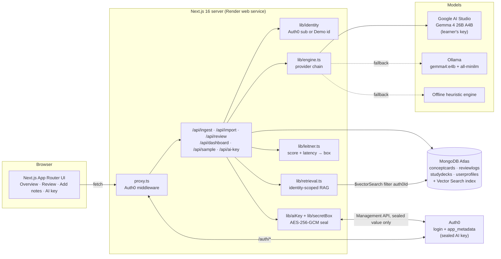
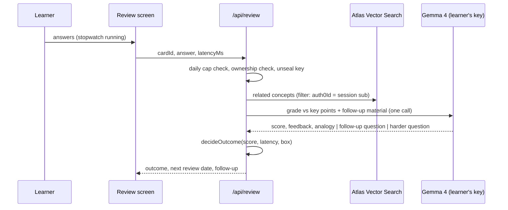

# DeepRetain: The Forgetting-Curve Knowledge Engine

> Study less. Remember more. An anti-cramming study app that turns your notes into a few short reviews a day.

DeepRetain splits dense lecture notes into single concepts, then a **latency-aware Leitner system** decides when you see each one again, based on *how accurately* and *how fluently* you recall it. A **daily cap** stops you before cramming starts. Spacing does the rest.

Built for the **Hacktoberfest 2026 Open-Source AI Challenge, Week 3: "Slow and Steady"**.

## Open-source AI at the core

Every answer is graded by **Gemma 4**, Google's open model family, released under **Apache 2.0**.

- **Hosted, free:** `gemma-4-26b-a4b-it` on Google AI Studio, called with each learner's own free key. It is a mixture of experts that runs about 4B parameters per token, so grading comes back quickly.
- **Self-hosted:** the same model family runs on your own machine through [Ollama](https://ollama.com) (`gemma4:e4b` by default), so notes never have to leave it.
- **Offline:** if neither is reachable, an open-source heuristic grader in this repo keeps the study loop going.

Because the weights are open, anyone can inspect, self-host, or fine-tune the grader, and DeepRetain doesn't depend on one vendor's closed model.

## The lazy payoff

Cramming feels productive and fades within days. DeepRetain asks for about **15 short answers a day, at most**, and schedules them just before you'd forget. That's when a single recall does the most good.

| What you do | What DeepRetain does |
|---|---|
| Paste notes or import a file | The AI splits them into concepts, key points, and a first question |
| Answer one card | A quiet stopwatch measures recall time while the model grades meaning, not wording |
| Answer fast and right | The card climbs a Leitner box (1 → 3 → 7 → 14 → 30 days), and the next question gets harder |
| Answer right but slowly | The card stays put and you get a follow-up question |
| Answer wrong | Back to box 1, with a two-sentence analogy that fixes the misconception |
| Hit 15 reviews | Reviews lock until tomorrow |

## Demo vs signed in

| | Demo Mode | Signed in (Auth0) |
|---|---|---|
| Decks | The two sample decks only (AP Biology, CS) | Your own notes only. Sample decks are removed |
| Adding notes | No | Paste, or import `.md`, `.txt`, `.pdf`, `.docx` (up to 25 MB) |
| Grading | Ollama if the server has it, else the offline grader | Gemma 4 with **your own free key**, then Ollama, then the offline grader |

## Features

- **Bring your own free AI key.** Signed-in learners create a key at [aistudio.google.com/api-keys](https://aistudio.google.com/api-keys) and paste it on the **AI key** tab. The default model, `gemma-4-26b-a4b-it`, is open (Apache 2.0), free on AI Studio, and fast; grading runs with thinking off. The server has no key of its own.
- **Keys are encrypted before they reach Auth0.** The browser sends the key over HTTPS. The server checks it with Google, seals it with AES-256-GCM (key derived from `AUTH0_SECRET` with HKDF, bound to the learner's Auth0 `sub`), and stores only the sealed value in the user's Auth0 `app_metadata` through the Management API. It is never stored in MongoDB and never returned in full.
- **Note import.** Markdown and text are read as-is; PDFs go through `unpdf` and Word files through `mammoth`. The extracted text lands in the editor to check before cards are made, and the file isn't kept.
- **Latency-aware review.** One card at a time, with a stopwatch that can be hidden and pauses while the tab is hidden. The model's 0–100 score is combined with `responseLatencyMs`.
- **Adaptive difficulty.** Box 1 asks *recall* questions, box 2 *application*, box 3+ *synthesis*. On promotion, the model writes the next, harder question, often linking the concept to a related one from your own deck.
- **Identity-scoped RAG.** Related concepts come from Atlas Vector Search, **pre-filtered by the signed-in Auth0 `sub`** and re-checked before anything reaches the prompt.
- **Anti-cramming pacer.** A daily cap (default 15) counted on the learner's local day.
- **Cramming vs DeepRetain** on the sign-in page: modeled recall of one concept over six weeks. The crammer studies for an exam on **day 28**, then crams again on **day 40**, the night before the **AP Exam on day 41**, but that burst only gets recall back to 25%. DeepRetain teaches the concept on day 0 and reviews it on days 1, 4, 11 and 25. A table under the chart gives the values on exam day, a week later, and on AP Exam day.
- **Dashboard.** Leitner box distribution and a recall-time trend with a 7-day average.

## Architecture



### Review flow



### Leitner rules (`lib/leitner.ts`)

| Accuracy | Latency | Outcome | Box | Next review |
|---|---|---|---|---|
| ≥ 80% | < 12s | **Promote** and generate a harder question | +1 (max 5) | 1 / 3 / 7 / 14 / 30 days by new box |
| ≥ 80% | ≥ 12s | **Hesitation**: follow-up question | unchanged | current box interval |
| < 80% | any | **Reset**: two-sentence analogy | 1 | 1 day |

New concepts are due right away for their first recall pass, then follow the box intervals.

### Provider chain (`lib/engine.ts`)

1. **Google AI Studio with the learner's key**: `gemma-4-26b-a4b-it` with a system instruction, a JSON response schema and thinking off (`minimal`). If the key can't reach that model (HTTP 404) the next one, `gemma-4-31b-it`, is tried. `GOOGLE_AI_MODEL` pins a single model. A rejected key skips straight to the next engine.
2. **Ollama** (`OLLAMA_BASE_URL`): Gemma 4 (`gemma4:e4b`, or `OLLAMA_MODEL`) with Ollama structured outputs. Used for Demo Mode and for learners without a key.
3. **Offline heuristic engine**: lexical key-point coverage plus templated follow-up questions and analogies.

Every response reports the engine that produced it.

## Tech stack

| Layer | Choice |
|---|---|
| Framework | Next.js 16 (App Router, Cache Components, `proxy.ts`), React 19, TypeScript |
| UI | Tailwind CSS 4 with light and dark tokens, IBM Plex Sans/Mono, Lucide icons, Recharts 3 |
| AI | Gemma 4 (Apache 2.0): 26B A4B on Google AI Studio (learner's key), `gemma4:e4b` on Ollama, `all-minilm` embeddings |
| Import | `unpdf` (PDF), `mammoth` (Word) |
| Data | MongoDB Atlas with Mongoose 9 and Atlas Vector Search (384-dim, cosine, filtered by `auth0Id`) |
| Auth | `@auth0/nextjs-auth0` v4 plus the Auth0 Management API for the sealed key; Demo Mode for judges |
| Deploy | Render Blueprint (`render.yaml`) |
| Tests | Vitest (Leitner rules, retention maths, pacer, JSON parsing, heuristic engine, provider chain, key sealing, Auth0 storage, file import, demo/sign-in gates, authz guards) |

## Run it locally

**Prerequisites:** Node 20.9+ and an Atlas cluster (the free M0 works). [Ollama](https://ollama.com) is optional.

```bash
ollama pull gemma4:e4b      # optional: grading without a learner key (gemma4:26b matches the hosted model)
ollama pull all-minilm      # optional: 384-dim embeddings
```

```bash
npm install
cp .env.example .env.local  # then fill in MONGODB_URI (Auth0 is optional)
npm run db:vector-index     # creates the Atlas Vector Search index and waits until it is READY
npm run dev                 # http://localhost:3000
```

Open the app and click **Try the demo**, then pick a sample deck. Answer quickly and correctly to see a promotion, take more than 12 seconds to get a follow-up question, or answer wrong to get an analogy. To add your own notes, sign in and save your AI key on the **AI key** tab.

### Scripts

| Command | What it does |
|---|---|
| `npm run dev` | Dev server (Turbopack) |
| `npm run build && npm start` | Production build and server (what Render runs) |
| `npm test` | Unit tests |
| `npm run typecheck` / `npm run lint` | TypeScript and ESLint |
| `npm run db:vector-index` | Create the Atlas Vector Search index from `atlas/vector-index.json` |

## Configure services

### MongoDB Atlas
1. Create a cluster and a database user, then copy the `mongodb+srv://` URI into `MONGODB_URI`.
2. In **Network Access**, allow your IP. For Render, allow `0.0.0.0/0` (Render's free tier has no static IPs).
3. Run `npm run db:vector-index`, or create the index by hand from [`atlas/vector-index.json`](atlas/vector-index.json): a `vectorSearch` index on `conceptcards.embedding` (384 dims, cosine) with filter fields `auth0Id` and `embeddingModel`.

Without the index, retrieval falls back to in-app cosine similarity over the same user-scoped documents.

### Auth0 (optional)
1. Create a **Regular Web Application**.
2. Allowed Callback URL: `https://<your-app>/auth/callback`. Allowed Logout URL: `https://<your-app>`.
3. Set `AUTH0_DOMAIN`, `AUTH0_CLIENT_ID`, `AUTH0_CLIENT_SECRET`, and `AUTH0_SECRET` (`openssl rand -hex 32`).
4. **Let the app store learners' AI keys.** In the Auth0 dashboard, open **Applications → APIs → Auth0 Management API → Machine to Machine Applications**, authorize your application, and grant `read:users` and `update:users_app_metadata`. Make sure **Client Credentials** is enabled under the application's **Advanced Settings → Grant Types**. To use a separate machine-to-machine app instead, set `AUTH0_MANAGEMENT_CLIENT_ID` and `AUTH0_MANAGEMENT_CLIENT_SECRET`. If `AUTH0_DOMAIN` is a custom domain, set `AUTH0_MANAGEMENT_DOMAIN` to the tenant's `*.auth0.com` domain.

When the Auth0 variables are missing, the app runs in Demo Mode only and hides sign-in.

**Sign-in sends you to a broken localhost page?** The app told Auth0 to return to `localhost`. On Render, leave `APP_BASE_URL` unset (the app uses `RENDER_EXTERNAL_URL`) or set it to your public `https://` URL; a `localhost` value is now ignored there. Then check that the Auth0 application lists `https://<service>.onrender.com/auth/callback` under Allowed Callback URLs. `GET /api/health` shows the URL in use as `auth.baseUrl`.

`AUTH0_SECRET` also derives the key that seals learners' AI keys. Rotating it signs everyone out and means they need to paste their key again.

### Learner AI keys
Nothing to configure on the server. Each learner:
1. Goes to [aistudio.google.com/api-keys](https://aistudio.google.com/api-keys) and signs in with a Google account.
2. Chooses **Create API key** (the free tier needs no billing).
3. Pastes it on DeepRetain's **AI key** tab. The page tells them the key will be sent encrypted.

Free-tier keys have rate limits; when a learner hits one, grading falls back to Ollama or the offline grader until it resets. On the free tier Google may use prompts to improve its products, and the settings page says so.

## Deploy to Render

1. Push this repository to GitHub.
2. In Render, choose **New → Blueprint**, select the repo, and Render reads [`render.yaml`](render.yaml).
3. Fill in the prompted secrets. `MONGODB_URI` is required, the rest are optional. `AUTH0_SECRET` is generated for you. Don't copy `APP_BASE_URL=http://localhost:3000` from `.env.example`: leave it unset and the app uses Render's external URL.
4. Add `https://<service>.onrender.com/auth/callback` to your Auth0 application, and authorize it for the Management API (step 4 above).

## Demo Mode

**Try the demo** sets an httpOnly cookie with a random `demo|<uuid>` learner id, so every judge gets an isolated workspace. That id format can never collide with or impersonate an `auth0|…` user. Demo Mode only offers the sample decks: `/api/ingest` and `/api/import` refuse demo learners, and there is no AI key, so grading uses Ollama if the server has it and the offline grader otherwise. **Reset** wipes the demo learner's data, and **Exit** clears the cookie. Set `DEMO_MODE_ENABLED=false` to turn it off.

Sample decks include three weeks of **simulated** review history so the charts have a trend to show. Those logs are flagged `simulated: true`, labeled in the UI, and never count toward the daily cap.

## API

| Route | Purpose |
|---|---|
| `POST /api/ingest` | Signed in only. `{ deckTitle, rawText }` → extraction → embeddings → cards in box 1 |
| `POST /api/import` | Signed in only. Multipart `file` (`.md`, `.txt`, `.pdf`, `.docx`, ≤ 25 MB) → `{ title, text, truncated }`. Nothing is stored |
| `GET/PUT/DELETE /api/ai-key` | Signed in only. Key status (`saved`, `hint`, `model`), save `{ apiKey }` (verified with Google, sealed, stored in Auth0), or remove |
| `POST /api/review` | `{ mode: "answer", cardId, answer, latencyMs, tzOffsetMinutes }` → grade, Leitner move, log. `{ mode: "followup", reviewLogId, answer }` → follow-up reply |
| `GET /api/dashboard?tz=` | Due cards, box stats, cap status, latency trend, AI key status. Removes sample decks from signed-in accounts |
| `POST /api/sample` | Demo Mode only. `{ deck: "bio" \| "cs" }` → curated sample deck |
| `POST/DELETE /api/demo` | Enter Demo Mode, or reset it (`?exit=1` to leave) |
| `GET /api/health` | Mongo, Ollama, model, and Auth0 status (Render health check) |

All data routes resolve the caller first and scope every query by `auth0Id`.

## Project structure

```
app/                 App Router pages and API routes
components/          AppShell, Landing, charts, dashboard, ingest editor, review, AI key settings
lib/engine.ts        extractConceptsFromNotes · evaluateAndFollowUp · replyToFollowUp
lib/ai/              Google AI Studio / Ollama / heuristic providers, prompts, embeddings
lib/aiKey.ts         Learner AI keys: load, save, remove (sealed, stored in Auth0)
lib/secretBox.ts     AES-256-GCM sealing
lib/auth0Management.ts  Minimal Management API client (app_metadata)
lib/importNotes.ts   Text from .md / .txt / .pdf / .docx
lib/leitner.ts       Box rules (accuracy × latency)
lib/retrieval.ts     Identity-scoped Atlas Vector Search
lib/retention.ts     Forgetting-curve and latency-trend maths
lib/pacer.ts         Daily cap
models/              ConceptCard · ReviewLog · StudyDeck · UserProfile
scripts/             Atlas vector index setup
tests/               Vitest suites
render.yaml          Render Blueprint
```

## Notes on the design

The UI uses warm neutral surfaces, hairline borders and one accent color, with separate light and dark values defined as tokens in `app/globals.css`. Chart series colors were checked with a colorblind-safety validator against both chart surfaces: blue `#2a78d6` / `#3987e5` for DeepRetain and single-series charts, and orange `#eb6834` / `#d95926` for cramming. Every multi-series chart has a legend and hover tooltips, and the retention chart has a table of its key values.

## License

MIT. See [LICENSE](LICENSE).
